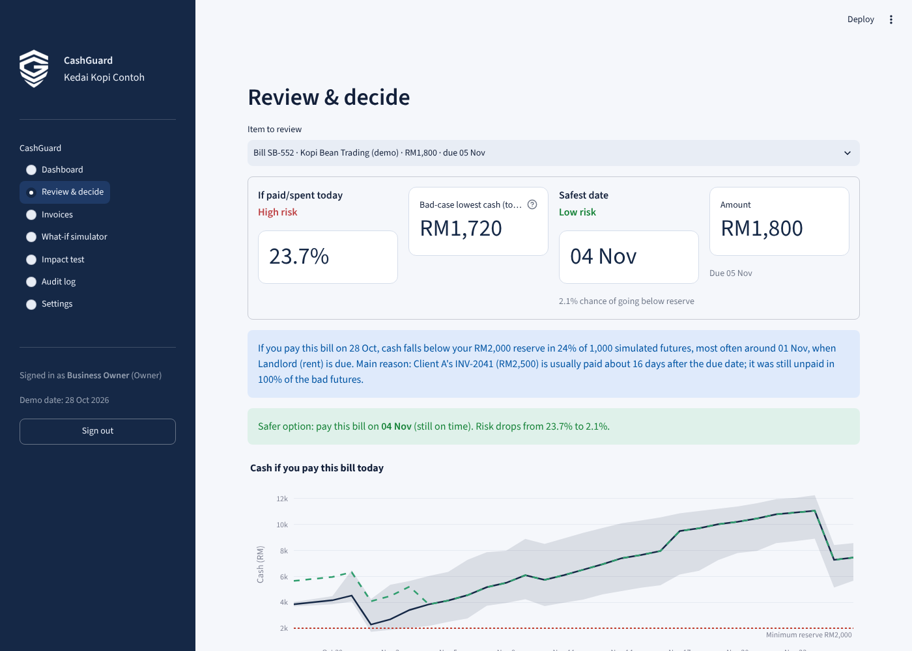
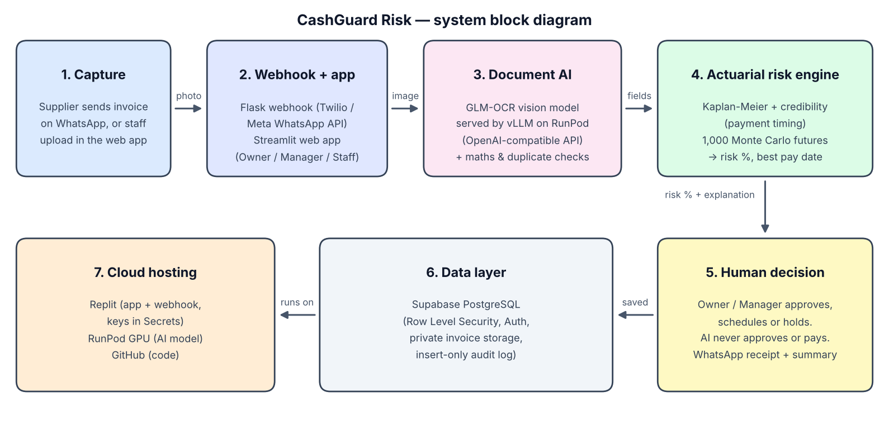

<p align="center"></p>

# CashGuard Risk

> An actuarial cash-safety check that tells micro and small business owners the safest day to pay a bill, before cash runs short.



---

## Team Information

| Field | Details |
|---|---|
| **Team Name** | Extragorjoss |
| **Team Domain** | Domain 2 |
| **SDG Track (1–17)** | SDG 8 — Decent Work and Economic Growth (Targets 8.2 & 8.3) |
| **Team Leader** | Muhammad Ameer Amsyar bin Hamdan |
| **University** | Universiti Teknologi MARA (UiTM); Universiti Teknikal Malaysia Melaka (UTeM) |
| **Number of Members** | 5 |

## Submission Documents

| Document | File |
|---|---|
| Preliminary proposal | [`submission/SDC2026_Extragorjoss_Preliminary.pdf`](submission/SDC2026_Extragorjoss_Preliminary.pdf) |
| Technology declaration | [`submission/SDC2026_Extragorjoss_TechDeclaration.pdf`](submission/SDC2026_Extragorjoss_TechDeclaration.pdf) |
| Replit proof of use | `submission/SDC2026_Extragorjoss_Replit_POU.pdf` |
| RunPod proof of use | `submission/SDC2026_Extragorjoss_Runpod_POU.pdf` |

---

## The Problem

Owners of cafés, workshops and shops decide what to pay by looking at today's bank balance. That balance ignores
rent and payroll due next week and customers who pay late. Malaysian SMEs wait an average of 64 days to be paid
([Experian, State of Credit 2025](https://www.experian.com.my/2025/05/21/experian-malaysias-state-of-credit-2025-reveals-sme-resilience-but-cash-flow-strains-persist/)),
and MSMEs provide 48.7% of Malaysia's jobs ([DOSM, 2025](https://www.dosm.gov.my/portal-main/release-content/micro-small--medium-enterprises-msmes-performance-2024)).
Paying the wrong bill on the wrong day can leave no cash for wages.

## The Solution

1. A supplier sends an invoice photo on **WhatsApp**, or staff upload it.
2. **Document AI** (GLM-OCR on RunPod) reads the supplier, amount, due date and line items. Staff check them and confirm.
3. The **actuarial risk engine** predicts when customers will really pay (Kaplan-Meier survival analysis + Bühlmann credibility). It then runs **1,000 Monte Carlo cash futures**.
4. The owner sees the **risk %** of paying today, the **safest date that is still on time**, and a plain-language reason.
5. The **owner decides**. Every decision goes into an insert-only audit log. AI never approves or pays anything.

## WhatsApp invoice bot

Suppliers can send an invoice in two ways:

1. **A photo or PDF of their own invoice.** The AI model reads it, and staff confirm the fields.
2. **No invoice ready?** They type **INVOICE**. The bot replies with a fill-in form, they send it back, and
   CashGuard **generates the invoice PDF** for them (`src/whatsapp/invoice_form.py`).

The bot fills in anything left blank with defaults: the invoice no., the invoice date, a due date from the
supplier's usual terms (default 30 days), bill-to, and **payment by online bank transfer / DuitNow**, so nobody
collects cash in person. It saves the supplier's details, so the next form comes pre-filled. If the bank
details differ from the saved ones, the bill is flagged for a phone check before paying (a common fraud pattern).
Set `PUBLIC_BASE_URL` so the bot can send the generated PDF back on WhatsApp.

**Suppliers get updates automatically** (`src/whatsapp/notify.py`):

- when their invoice is received and sent for approval
- when it is approved, with the transfer date and due date
- when the payment is made

They never see the business's cash figures. The Owner can turn updates off in Settings.

**Sharing the bot:** suppliers install nothing. In **Settings → Share the invoice bot with suppliers**, the Owner
gets a `wa.me` link and a QR code (it opens WhatsApp with "INVOICE" already typed), plus a ready-to-send message.

## Results (synthetic demo data)

| Check | Result |
|---|---|
| Impact test: 50 bill situations, judged on futures the model did not see | Shortfall rate **14.4% → 3.3%** (**77% fewer**). **50/50 bills paid on time** |
| Payment-timing error (backtest) | **4.4 days**, vs 6.2 days if we assume customers pay on the due date |
| Calibration: predicted vs actual "paid within 7 days of due date" | 76% vs 73% |
| Demo bill (RM1,800, due 5 Nov) | Pay today **23.7% High risk**. Pay on 4 Nov **2.1% Low risk** |

---

## Project Structure

```
.
├── docs/
│   ├── architecture.png          # System block diagram
│   └── screenshots/              # App screenshots
├── runpod/
│   ├── handler.py                # RunPod serverless handler (GPU invoice reading)
│   └── requirements.txt
├── src/
│   ├── main.py                   # Application entry point (starts the Streamlit app)
│   ├── app.py                    # Web app: screens, roles, decisions
│   ├── utils.py                  # Helper functions
│   ├── engine/                   # Actuarial risk engine
│   │   ├── payments.py           #   Kaplan-Meier, credibility, backtest, calibration
│   │   ├── montecarlo.py         #   Cash timeline + 1,000-path Monte Carlo
│   │   ├── explain.py            #   Best date, explanation, chase suggestion
│   │   └── impact.py             #   Out-of-sample impact test
│   ├── capture/extract.py        # Invoice reading (RunPod model → fallback) + checks
│   ├── whatsapp/                 # WhatsApp inbox + replies
│   ├── whatsapp_webhook.py       # Flask webhook (Twilio / Meta WhatsApp Cloud API)
│   ├── policy.py                 # Spending categories + staff limits
│   ├── data_store.py, audit.py   # Storage + insert-only audit log
│   ├── make_data.py              # Synthetic (fictional) demo data
│   └── demo_invoices/            # Fictional invoices + sample bank statement
├── submission/                   # Required submission documents
├── supabase/schema.sql           # Production database with Row Level Security
├── tests/
│   └── test_utils.py             # Unit tests
├── .env.example                  # Example environment variables
├── .gitignore
├── .replit                       # Replit run configuration
├── LICENSE
├── requirements.txt              # Python dependencies
└── README.md
```

## Architecture



```
WhatsApp / upload ──► Replit (Streamlit app + webhook) ──► RunPod endpoint (GLM-OCR, GPU)
                                   │                                    │
                                   │◄──────── invoice fields (JSON) ────┘
                                   ▼
                      Risk engine (Python) ──► Owner / Manager decides ──► database + audit log
```

| Layer | Technology |
|---|---|
| Front end | Streamlit (Python), Plotly |
| Input channel | WhatsApp via Twilio API (or Meta WhatsApp Cloud API), Flask webhook |
| AI model | GLM-OCR (MIT licence) on a RunPod Serverless vLLM endpoint (OpenAI-compatible API) |
| Risk engine | NumPy, pandas: Kaplan-Meier, Bühlmann credibility, Monte Carlo |
| Database | CSV/JSON for the demo; Supabase PostgreSQL with Row Level Security for production |
| Hosting | Replit (app + webhook), RunPod (GPU model) |

---

## How to Run

### Option 1 — Run on Replit (Recommended)

1. Import this repository via **Create Repl → Import from GitHub**.
2. Open the **Secrets** tab (🔒) and add the variables listed in `.env.example`:
   - `RUNPOD_API_KEY`
   - `RUNPOD_ENDPOINT_ID`
   - optional: `TWILIO_ACCOUNT_SID`, `TWILIO_AUTH_TOKEN`, `TWILIO_WHATSAPP_FROM`, `PUBLIC_URL`, `WHATSAPP_WEBHOOK=1`
3. Click **Run**. Replit uses the `.replit` file to start `python src/main.py`, which opens the web app.

The app works **without any keys**. Demo invoices use pre-extracted fields, and the Upload bill page has a
WhatsApp simulator, so judges can always try the full flow.

### Option 2 — Run Locally

```bash
# 1. Clone the repository
git clone https://github.com/<your-username>/CashGuard.git
cd CashGuard

# 2. Create and activate a virtual environment
python -m venv venv
source venv/bin/activate        # Windows: venv\Scripts\activate

# 3. Install dependencies
pip install -r requirements.txt

# 4. Configure environment variables (optional)
cp .env.example .env            # then fill in your values

# 5. Run the app
python src/main.py              # opens http://localhost:8501
```

### Setting up the RunPod model

1. In RunPod, go to **Serverless → New Endpoint** and use the ready-made **vLLM** worker with the model `zai-org/GLM-OCR`.
2. Copy the endpoint ID and your RunPod API key into `RUNPOD_ENDPOINT_ID` and `RUNPOD_API_KEY`.
3. The app calls `https://api.runpod.ai/v2/<ENDPOINT_ID>/openai/v1/chat/completions`. If the model is unavailable, it falls back to demo fields or manual entry.

`runpod/handler.py` is an optional custom worker if you build your own worker image instead.

### First run: set up your business

The first screen asks the owner for the **business name**, address, an optional business WhatsApp number,
cash today, a minimum reserve and usual payment terms. All of these can be changed later in **Settings**.
The bills, customers and sales after that are fictional sample data, so you can explore straight away.
Demo phone numbers start with `+60 0...`, which is never a real Malaysian number.

### Demo logins (simulated, no passwords)

| Role | Can do |
|---|---|
| **Owner** | Dashboard, review & decide everything, settings, audit log, impact test |
| **Manager** | Decide items within the limits the Owner sets (default RM300 per item, RM1,500 per month), never their own submissions |
| **Employee** | Upload bills, WhatsApp inbox, submit expense requests (within category limits) |

## Run Tests

```bash
pytest -q
```

The 12 tests cover supplier WhatsApp updates and the share link, the WhatsApp invoice form (defaults, saved details, bank-change flag, PDF), the Kaplan-Meier survival maths (checked by hand), the credibility weights, the line-item
maths check, duplicate blocking, repeatable simulations, the "never later than the due date" rule, and staff
spending limits.

---

## Privacy & Responsible AI

- **Synthetic data only.** Every business, customer and invoice is fictional.
- **Keys are never in this repository.** Use Replit Secrets or `.env`, which is git-ignored.
- **AI only reads invoices.** Staff confirm every field. The maths decides the risk, and a person decides the payment.
- **Decision support, not financial advice.** The app makes no real payments, sends no real reminders and files nothing.

## License

See [LICENSE](LICENSE).
